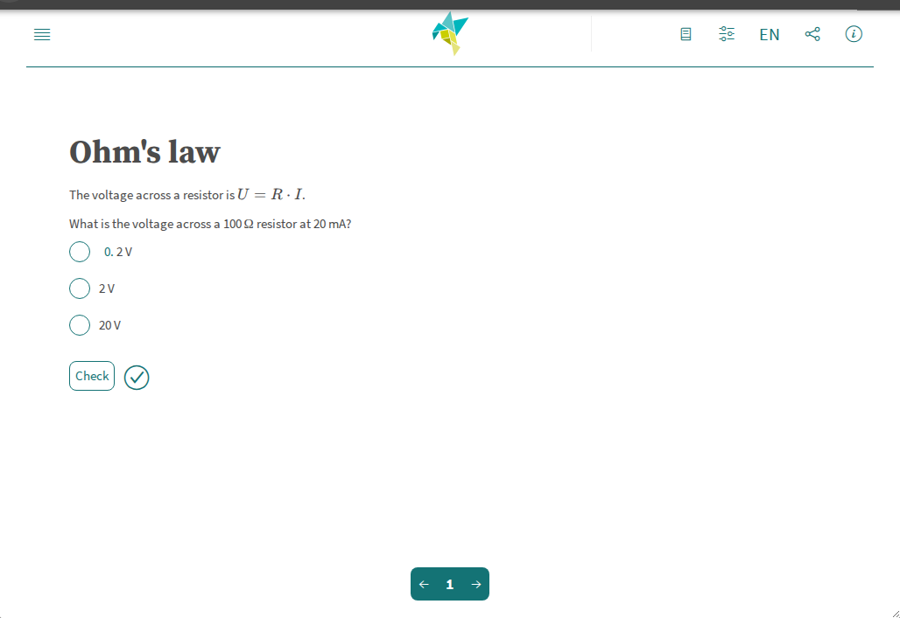

# Edrys LiaScript Module

Add interactive course material to an Edrys class: slides, quizzes, surveys, executable code, galleries,
formulas, animations and text-to-speech. The module shows a [LiaScript](https://liascript.github.io) course, which
is plain Markdown, either from a URL or written directly in the module settings. It is shown in every room
(`show-in: *`), and every role sees the same course.



## Usage

Add the module to your class with this URL:

```
https://edrys-labs.github.io/module-liascript/
```

## Configuration

Open the module in the class settings. The general tab has these fields:

| Field | Meaning |
|-------|---------|
| **course** | URL of a LiaScript course, i.e. its raw Markdown, e.g. `https://raw.githubusercontent.com/<user>/<repo>/main/README.md`. If set, **content** is ignored. |
| **content** | The course as LiaScript Markdown, written in the settings. Used when **course** is empty. |
| **classroom** | Classroom mode (off by default), see below. |
| **player** | The LiaScript player to use. Empty means `https://liascript.github.io/course/`. Set it to use a pinned or self-hosted build. |

Without a course or content, the module says what to set.

The course URL is fetched by LiaScript in each user's browser, so the server has to allow that (CORS). GitHub's
`raw.githubusercontent.com` URLs work.

Example `content`, with a quiz and a library loaded by the course:

````markdown
<!--
link:   https://cdn.jsdelivr.net/chartist.js/latest/chartist.min.css
script: https://cdn.jsdelivr.net/chartist.js/latest/chartist.min.js
-->

# Ohm's law

What is the voltage across a 100 Ω resistor at 20 mA?

- [( )] 0.2 V
- [(X)] 2 V
- [( )] 20 V

```javascript
new Chartist.Line('#chart', { labels: [1, 2, 3, 4], series: [[100, 120, 180, 200]] })
```
<script>@input</script>

<div class="ct-chart ct-golden-section" id="chart"></div>
````

If you edit the class configuration as YAML instead:

```yaml
config:
  course: https://raw.githubusercontent.com/<user>/<repo>/main/README.md
  classroom: true
```

## Classroom mode

With **classroom** on, the users of a room share one LiaScript classroom: quiz and survey results and a chat.
This includes the Lobby, where everyone in it shares one classroom. Each room has its own classroom, so users
who move to another room join that room's classroom there.

LiaScript opens its classroom dialog with the backend *Edrys* and the room already filled in. Each user joins
by clicking **connect** there.

How it works, for module authors: LiaScript sends `{subject, body}` messages to the module. The module answers
`init` itself, and sends all other messages to the room with `Edrys.sendMessage(subject, body)`. LiaScript
chooses the subject (an ID of the course and room), and the body is a base64 Yjs frame. Messages from the
other users go back into their LiaScript player. The module keeps no shared state.

## License

[MIT](LICENSE) © edrys-labs
